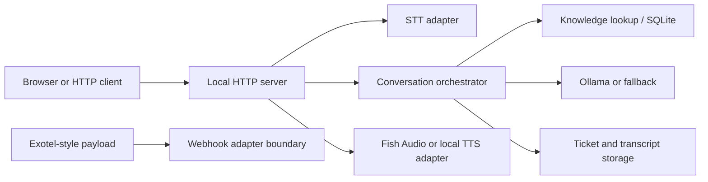

# VoxDesk

VoxDesk is a local-first voice-agent backend prototype for business support conversations. It addresses the need to keep organization knowledge, conversation decisions, transcripts, and support tickets in one testable service while speech and telephony integrations are developed.

## Implemented features

- SQLite persistence for organizations, knowledge, call transcripts, and support tickets.
- Conversation orchestration with knowledge lookup and LLM decision handling.
- Local HTTP endpoints and a `/browser-call` page for testing the voice loop.
- Configurable Ollama-compatible runtime and deterministic fallback behavior.
- Faster-Whisper STT and Fish Audio TTS adapter code, subject to local models or API credentials.
- Exotel-style inbound webhook parsing and WhatsApp dry-run boundaries.

A complete production telephone service, provider provisioning, outbound dialer, and live phone audio bridge are **not** implemented. The browser test page is the practical voice test surface today.

## Architecture and stack



The backend uses Python 3.11+, SQLite, a standard-library HTTP server, and optional FastAPI/Uvicorn. Runtime and speech adapters are in `backend/src/voice_agent/`.

## Local setup

```bash
cd backend
python3 -m venv .venv
. .venv/bin/activate
python -m pip install -e '.[dev]'
cd ..
cp .env.example .env
```

Set a strong `VOICE_AGENT_API_TOKEN` in `.env`. The default LLM is `fallback`, which needs no external service. To use Ollama, configure `VOICE_AGENT_LLM`, `OLLAMA_BASE_URL`, and `OLLAMA_MODEL`; to use Fish Audio, configure `FISH_API_KEY` and the TTS settings. Faster-Whisper may download model weights. `DATABASE_URL` and `REDIS_URL` in the example describe optional local infrastructure and are not required by the default SQLite HTTP path.

```bash
cd backend
set -a; . ../.env; set +a
PYTHONPATH=src python scripts/run_local_server.py
```

Open `http://127.0.0.1:8088/browser-call`; health is at `/health`. The `X-Voice-Agent-Token` header protects local data endpoints. Never publish this server without reviewing authentication, network exposure, webhook validation, and consent for call recordings.

## Tests and deployment

```bash
cd backend
PYTHONPATH=src python -m unittest discover tests -v
```

The tests cover orchestration, knowledge, storage, HTTP behavior, LLM payloads, TTS, and auth with local doubles. For deployment, provide durable database storage, real secrets, TLS, authenticated provider webhooks, model runtime capacity, and an approved telephony integration. `docker-compose.yml` contains optional development Postgres/Redis services with sample credentials; it is not a production deployment.

## Attribution and licensing

The maintainer confirmed publication rights for this application's source code. This local snapshot has no source Git history or root license file; no exclusive license is asserted over third-party adapters or assets. Add external audio assets only after verifying their redistribution terms.

Repository: [Gaurav598/VoxDesk-AI-Customer-Support-Voice-Agent](https://github.com/Gaurav598/VoxDesk-AI-Customer-Support-Voice-Agent)
